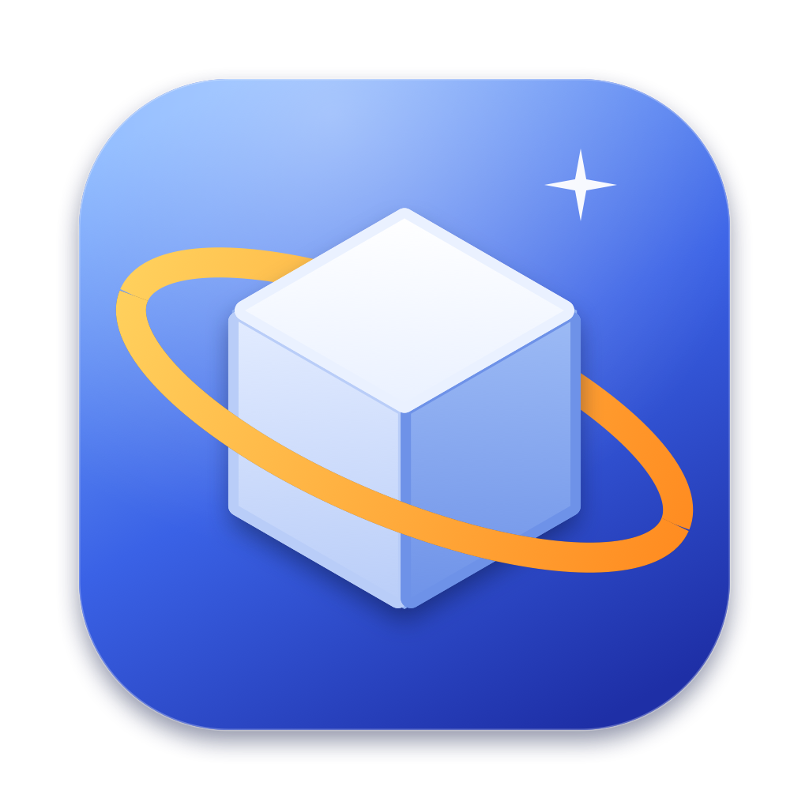
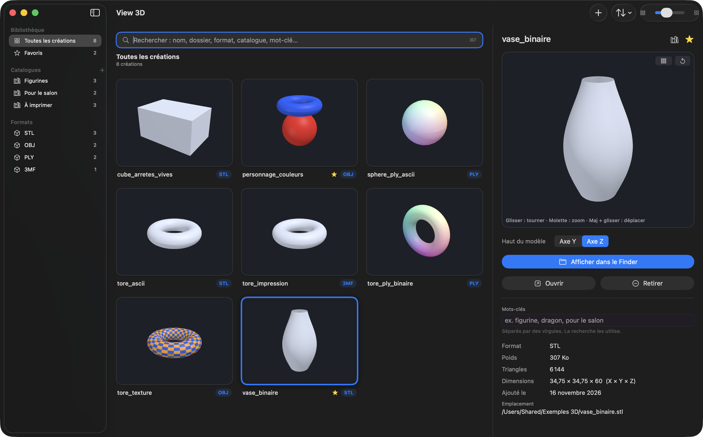
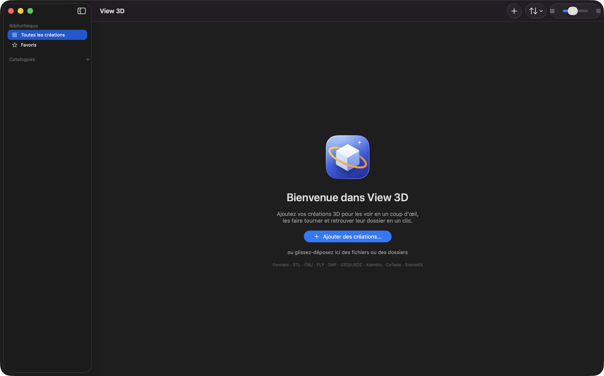
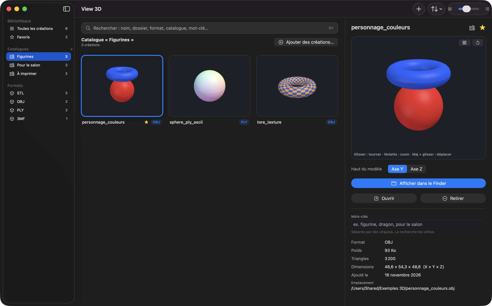
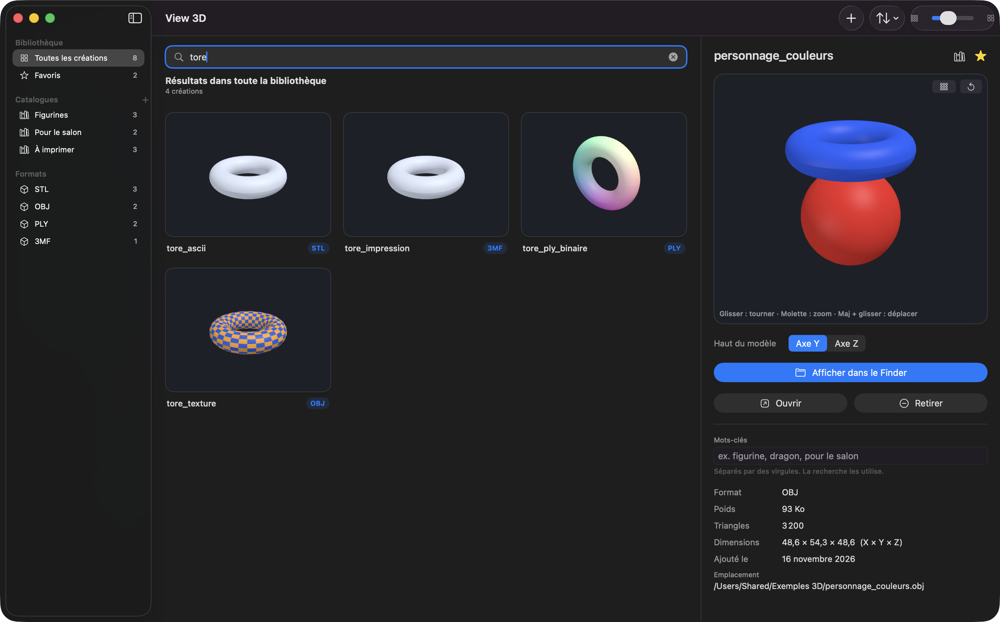
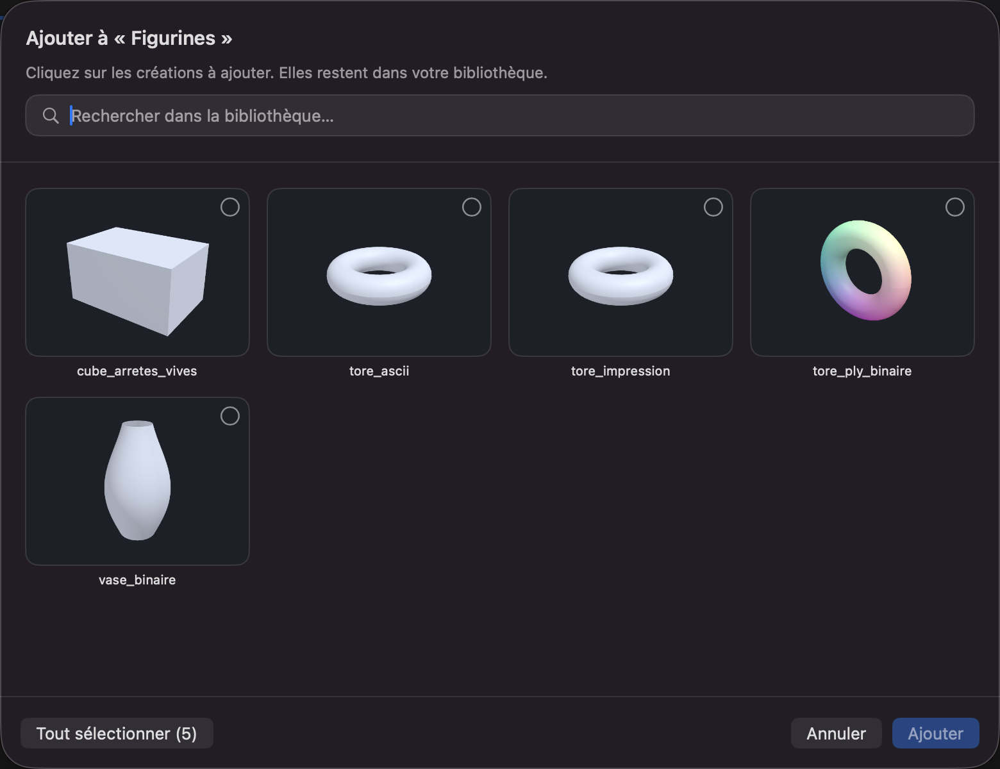

<div align="center">



# View 3D

**Preview your 3D creations (STL, OBJ, 3MF…), organize them into catalogs, and jump to their folder in one click.**

[](LICENSE)


[**Download**](https://github.com/Wudstyz/View3D/releases/latest) · [Version française](README.md)



</div>

---

View 3D is a **standalone Mac app** for 3D makers and designers. It gathers your 3D files in a visual library: a **thumbnail** for each creation, an interactive **3D preview** you can spin with the mouse, and a button that **opens the folder** where the file lives. Handy for picking from lots of models.

Your files are **never copied or modified**: View 3D only references them. "Remove" never deletes a file.

> The app interface is in French (the author's language).

## Features

- **Add** files or whole folders (+ button, ⌘O, or drag and drop).
- Automatic **thumbnails** and an **interactive 3D preview**: orbit, zoom, pan, wireframe mode, double-click to re-center.
- **Show in Finder** (⇧⌘R): opens the folder with the file selected.
- **Catalogs**: group creations (Figurines, Living room, To print…). One creation can belong to several catalogs. Inside a catalog, *Add creations…* picks from your whole library.
- Multi-criteria **search** (⌘F): several words at once, accent- and case-insensitive, across name, folder, format, catalogs and the **keywords** you add.
- **Multi-selection** (⌘ + click, ⇧ + click) to file several creations at once.
- Sorting, favorites, format filters, adjustable thumbnail size, info (file size, triangles, dimensions).
- Moved or deleted files are flagged "Introuvable" (not found). "Model up axis" (Y or Z) switch if a model shows up lying down.
- **Dark interface**, easier on the eyes during long working days.

**Formats**: STL (binary and ASCII), OBJ (`.mtl` colors and textures), PLY (colors), 3MF, USD/USDZ, Alembic, Collada (DAE), SceneKit (SCN).

## Screenshots

| | |
|---|---|
|  |  |
| *Welcome screen* | *A catalog with the 3D preview* |
|  |  |
| *Search across the whole library* | *Adding creations to a catalog* |

## Installation

1. Download `View3D-1.0.dmg` from the [Releases](https://github.com/Wudstyz/View3D/releases/latest), open it and drag **View 3D** into *Applications*.
2. **First launch**: the app is ad-hoc signed but **not notarized** by Apple (no paid developer account), so macOS may show a warning. **Right-click → Open**, then *Open*. Or in Terminal:
   ```bash
   xattr -dr com.apple.quarantine "/Applications/View 3D.app"
   ```
3. To verify the download: `shasum -a 256 View3D-1.0.dmg` must match the checksum published in the release.

**Nothing else to install** (no Homebrew, Python or Node). Requirements: **Apple Silicon (arm64)** Mac, **macOS 13 or later**.

## Getting started

1. Click **Ajouter des créations…** (Add creations) or drop a folder onto the window. The `examples/` folder has files to try.
2. Click a thumbnail: the 3D preview appears on the right. Drag to rotate, scroll to zoom.
3. **Afficher dans le Finder** (Show in Finder) opens the file's folder. Double-clicking a thumbnail opens the file in its default app.
4. Create a catalog with the **+** in the sidebar, then drag thumbnails onto it or use right-click → *Catalogues*.

Your data (creation list, catalogs, thumbnails) lives in `~/Library/Application Support/View 3D/`.

## Compatibility and known limitations

What was actually tested:

- Tested on **a single Mac** (Apple Silicon, macOS 26) with generated test files (`Tests/make_samples.py`): binary and ASCII STL, OBJ with colors and texture, ASCII and binary PLY, 3MF.
- **macOS 13–15** support comes from the build target setting; it has **not** been tried on those versions.
- **USD/USDZ, Alembic, Collada, SceneKit** go through SceneKit and are **not thoroughly tested**: a hand-written USDA file displayed incorrectly during testing.
- **3MF colors and materials** are not shown (shape only).
- No glTF/GLB, FBX or STEP yet.
- Files over 1.5 GB are refused; very large models (millions of triangles) were not performance-tested.
- **Not tested with a mouse**: file drag and drop, multi-selection (⌘/⇧ + click), double-clicking a thumbnail and adding keywords. Bugs are possible.

## Build from source

Requires Xcode or its command line tools (to build only, not to use the app).

```bash
./build_app.sh   # → build/View 3D.app (ad-hoc signed)
./make_dmg.sh    # → build/View3D-1.0.dmg + SHA-256 checksum
```

Handy: `VERSION=1.1 ./build_app.sh`. To test without touching your library: `VIEW3D_DATA_DIR=/some/folder open -n "build/View 3D.app"`.

## Code layout

| Folder / file | Purpose |
|---|---|
| `Sources/App.swift` | Entry point, menus, file opening |
| `Sources/ContentView.swift` | Main window, sidebar, grid, search, catalogs |
| `Sources/DetailPanel.swift` | Detail panel and interactive 3D preview |
| `Sources/Library.swift` | Library, catalogs, persistence, thumbnails |
| `Sources/Loaders.swift` | STL, OBJ, PLY, 3MF readers + SceneKit for the rest |
| `Sources/MeshBuilder.swift` | Meshes, smoothed normals, SceneKit geometry |
| `Sources/SceneFactory.swift` | Scene setup, camera, lighting, thumbnail rendering |
| `Resources/` | `Info.plist`, `icon.icns` |
| `Tools/make_icon.swift` | Generates the icon |
| `Tests/make_samples.py` | Generates test 3D files |
| `examples/` | 3D files to try the app |

## Contributing

Ideas, bug reports and pull requests are welcome: open an issue describing the file format and what happened (attaching a test file, if not confidential, helps a lot).

## License

[MIT](LICENSE) © 2026 Wudstyz. See [THIRD_PARTY_NOTICES.md](THIRD_PARTY_NOTICES.md). Mentioned trademarks belong to their owners; this project is not affiliated with any of them.
