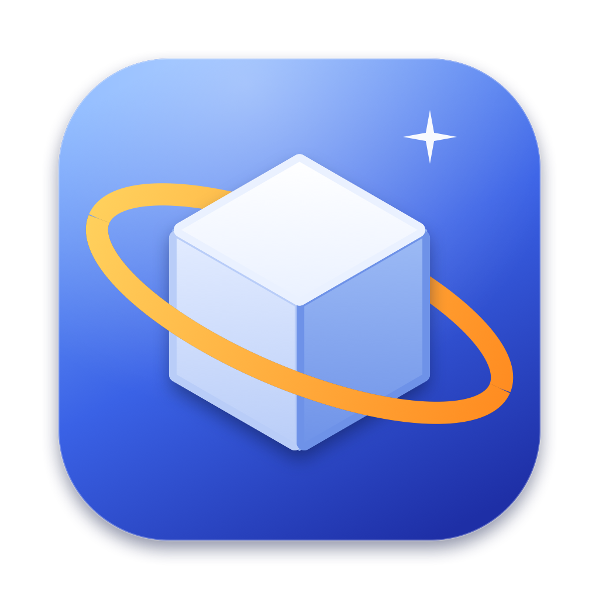
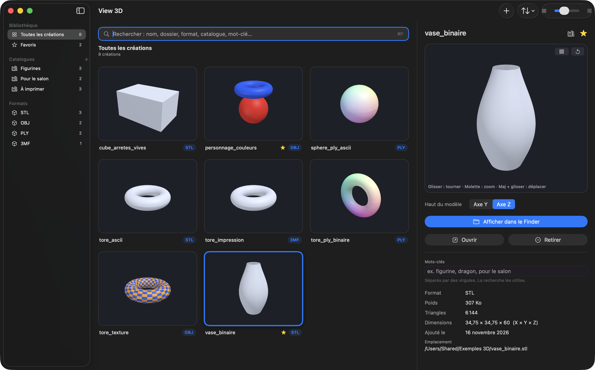
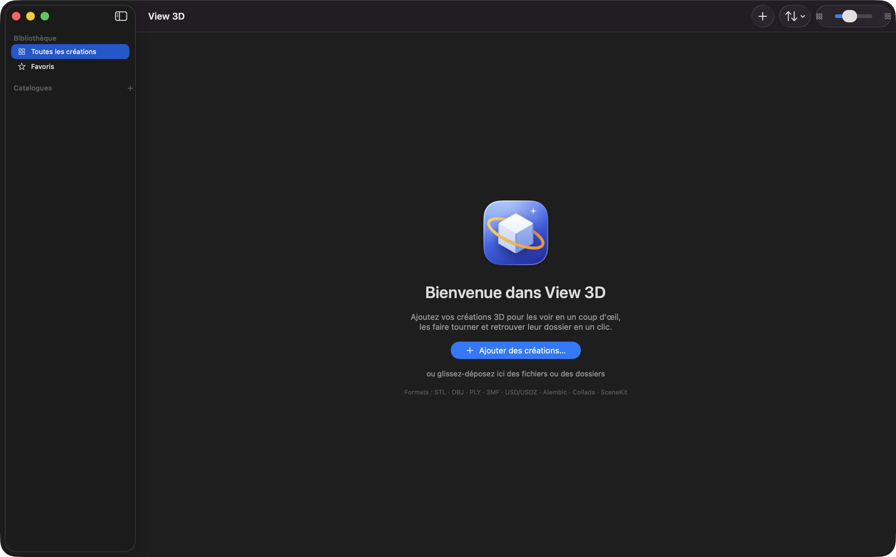
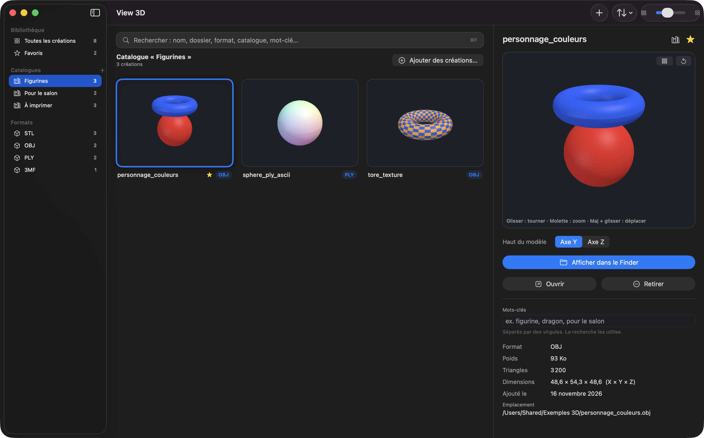
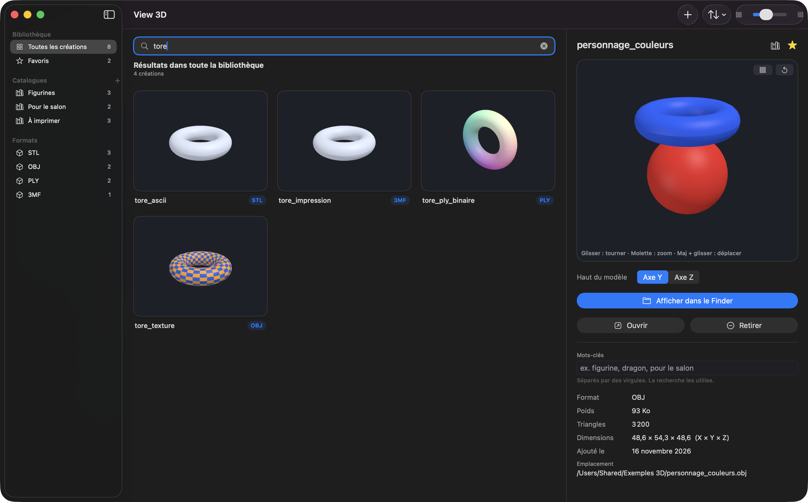
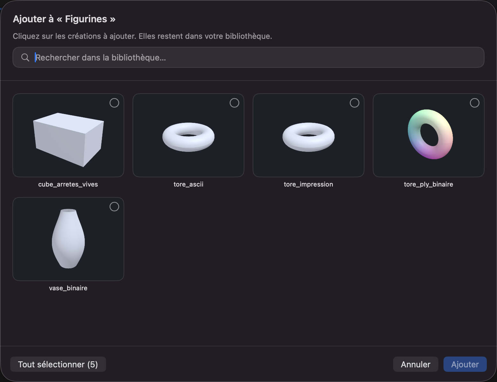

<div align="center">



# View 3D

**Prévisualisez vos créations 3D (STL, OBJ, 3MF…), rangez-les en catalogues et retrouvez leur dossier en un clic.**

[](LICENSE)


[**Télécharger**](https://github.com/Wudstyz/View3D/releases/latest) · [English version](README.en.md)



</div>

---

View 3D est une application **Mac autonome** pour les créateurs et designers 3D. Elle réunit vos fichiers 3D dans une bibliothèque visuelle : une **vignette** pour chaque création, un **aperçu 3D** que l'on fait tourner à la souris, et un bouton qui **ouvre le dossier** où se trouve le fichier. Idéal pour choisir plus facilement parmi beaucoup de modèles.

Vos fichiers **ne sont ni copiés ni modifiés** : View 3D ne fait que les référencer. « Retirer » ne supprime jamais le fichier.

## Ce que fait l'app

- **Ajouter** des fichiers ou des dossiers entiers (bouton +, ⌘O, ou glisser-déposer).
- **Vignettes** générées automatiquement et **aperçu 3D interactif** : tourner, zoomer, déplacer, mode fil de fer, double-clic pour recentrer.
- **Afficher dans le Finder** (⇧⌘R) : ouvre le dossier et sélectionne le fichier.
- **Catalogues** : regroupez des créations (Figurines, Pour le salon, À imprimer…). Une création peut être dans plusieurs catalogues. Dans un catalogue, *Ajouter des créations…* puise dans toute la bibliothèque.
- **Recherche** (⌘F) multi-critères : plusieurs mots à la fois, sans tenir compte des accents ni des majuscules, dans le nom, le dossier, le format, les catalogues et les **mots-clés** que vous ajoutez.
- **Sélection multiple** (⌘ + clic, ⇧ + clic) pour ranger plusieurs créations d'un coup.
- Tri, favoris, filtres par format, taille des vignettes réglable, infos (poids, triangles, dimensions).
- Un fichier déplacé ou supprimé est signalé « Introuvable ». Réglage « Haut du modèle » (axe Y ou Z) si un modèle apparaît couché.
- **Interface sombre**, pour ménager les yeux pendant les longues journées de travail.

**Formats** : STL (binaire et ASCII), OBJ (couleurs `.mtl` et textures), PLY (couleurs), 3MF, USD/USDZ, Alembic, Collada (DAE), SceneKit (SCN).

## Captures d'écran

| | |
|---|---|
|  |  |
| *Accueil* | *Un catalogue et l'aperçu 3D* |
|  |  |
| *Recherche dans toute la bibliothèque* | *Ajouter des créations à un catalogue* |

## Installation

1. Téléchargez `View3D-1.0.dmg` depuis les [Releases](https://github.com/Wudstyz/View3D/releases/latest), ouvrez-le et glissez **View 3D** dans *Applications*.
2. **Première ouverture** : l'app est signée en « ad hoc » mais **pas notarisée** par Apple (pas de compte développeur payant). macOS peut donc afficher un avertissement. Faites **clic droit → Ouvrir**, puis *Ouvrir*. Ou, dans le Terminal :
   ```bash
   xattr -dr com.apple.quarantine "/Applications/View 3D.app"
   ```
3. Pour vérifier le téléchargement : `shasum -a 256 View3D-1.0.dmg` doit donner la somme publiée dans la release.

**Rien d'autre à installer** (ni Homebrew, ni Python, ni Node). Prérequis : Mac **Apple Silicon (arm64)**, **macOS 13 ou plus récent**.

## Premiers pas

1. Cliquez sur **Ajouter des créations…** ou glissez un dossier dans la fenêtre. Le dossier `examples/` contient des fichiers pour essayer.
2. Cliquez sur une vignette : l'aperçu 3D s'affiche à droite. Glissez pour tourner, molette pour zoomer.
3. **Afficher dans le Finder** ouvre le dossier du fichier. Double-clic sur une vignette : ouvre le fichier avec l'application par défaut.
4. Créez un catalogue avec le **+** de la barre latérale, puis glissez-y des vignettes ou utilisez le clic droit → *Catalogues*.

Vos données (liste des créations, catalogues, vignettes) sont dans `~/Library/Application Support/View 3D/`.

## Compatibilité et limites connues

Ce qui a été testé, honnêtement :

- Testé sur **un seul Mac** (Apple Silicon, macOS 26), avec des fichiers de test générés (`Tests/make_samples.py`) : STL binaire et ASCII, OBJ avec couleurs et texture, PLY ASCII et binaire, 3MF.
- La compatibilité **macOS 13 à 15** vient du réglage de compilation, elle n'a **pas** été essayée sur ces versions.
- **USD/USDZ, Alembic, Collada, SceneKit** passent par SceneKit et ne sont **pas testés à fond** : un fichier USDA écrit à la main s'affichait mal pendant les tests.
- Les **couleurs et matériaux d'un 3MF** ne sont pas affichés (forme seule).
- Pas de glTF/GLB, FBX ni STEP pour l'instant.
- Les fichiers de plus de 1,5 Go sont refusés ; les très gros modèles (millions de triangles) n'ont pas été testés en performance.
- **Non testés à la souris** : le glisser-déposer de fichiers, la sélection multiple (⌘/⇧ + clic), le double-clic sur une vignette et l'ajout de mots-clés. Des bugs sont possibles.

## Construire depuis les sources

Nécessite Xcode ou ses outils en ligne de commande (pour construire seulement, pas pour utiliser l'app).

```bash
./build_app.sh   # → build/View 3D.app (signature ad hoc)
./make_dmg.sh    # → build/View3D-1.0.dmg + somme SHA-256
```

Variables utiles : `VERSION=1.1 ./build_app.sh`. Pour tester sans toucher à votre bibliothèque : `VIEW3D_DATA_DIR=/un/dossier open -n "build/View 3D.app"`.

## Organisation du code

| Dossier / fichier | Rôle |
|---|---|
| `Sources/App.swift` | Point d'entrée, menus, ouverture de fichiers |
| `Sources/ContentView.swift` | Fenêtre principale, barre latérale, grille, recherche, catalogues |
| `Sources/DetailPanel.swift` | Panneau de détail et aperçu 3D interactif |
| `Sources/Library.swift` | Bibliothèque, catalogues, sauvegarde, vignettes |
| `Sources/Loaders.swift` | Lecteurs STL, OBJ, PLY, 3MF + SceneKit pour le reste |
| `Sources/MeshBuilder.swift` | Maillage, normales lissées, géométrie SceneKit |
| `Sources/SceneFactory.swift` | Mise en scène, caméra, éclairage, rendu des vignettes |
| `Resources/` | `Info.plist`, `icon.icns` |
| `Tools/make_icon.swift` | Génère l'icône |
| `Tests/make_samples.py` | Génère des fichiers 3D de test |
| `examples/` | Fichiers 3D pour essayer l'app |

## Contribuer

Les idées, rapports de bugs et pull requests sont les bienvenus : ouvrez une *issue* en décrivant le format du fichier et ce qui s'est passé (joindre un fichier de test, s'il n'est pas confidentiel, aide beaucoup).

## Licence

[MIT](LICENSE) © 2026 Wudstyz. Voir [THIRD_PARTY_NOTICES.md](THIRD_PARTY_NOTICES.md). Les marques citées appartiennent à leurs propriétaires ; ce projet n'est affilié à aucun d'eux.
